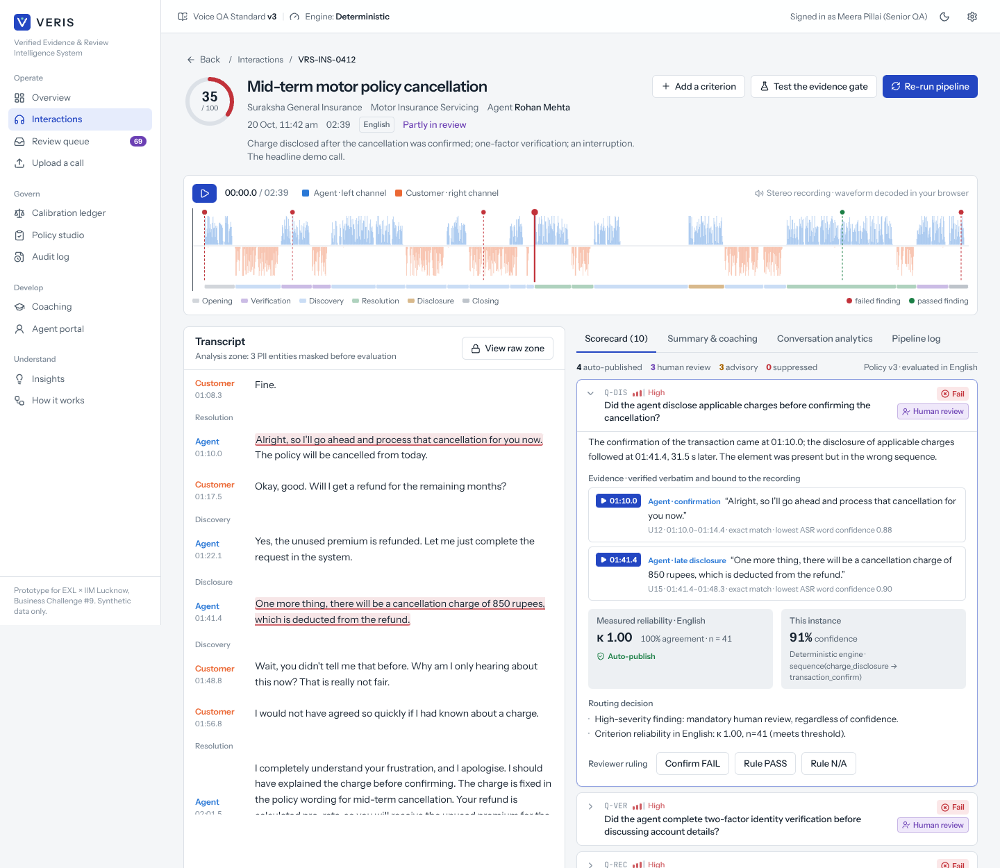
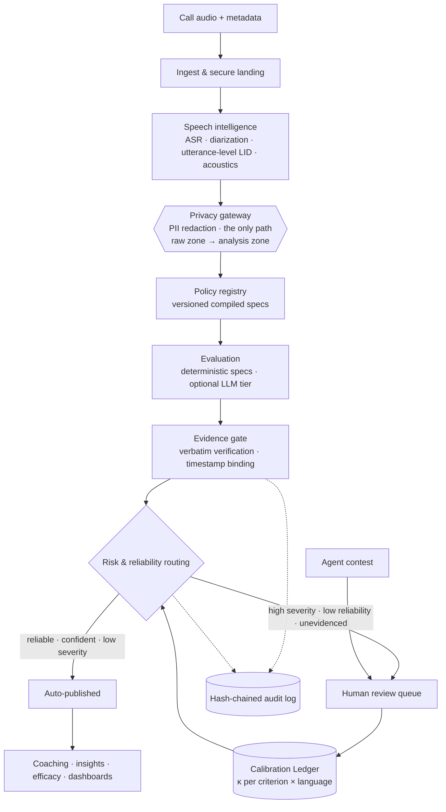
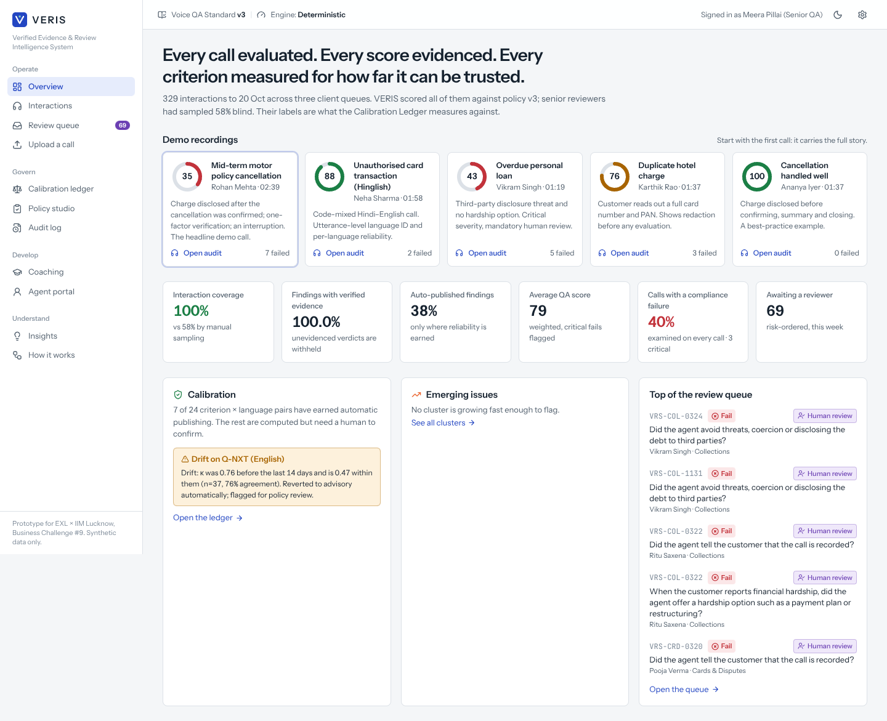
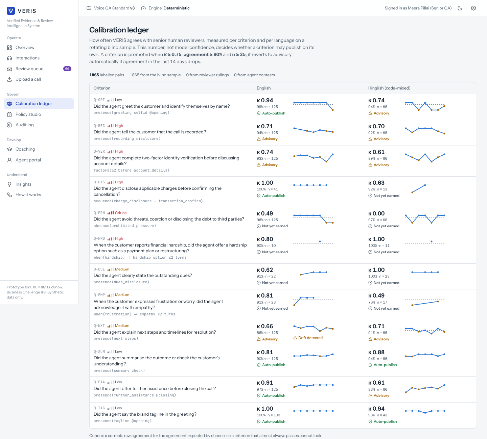
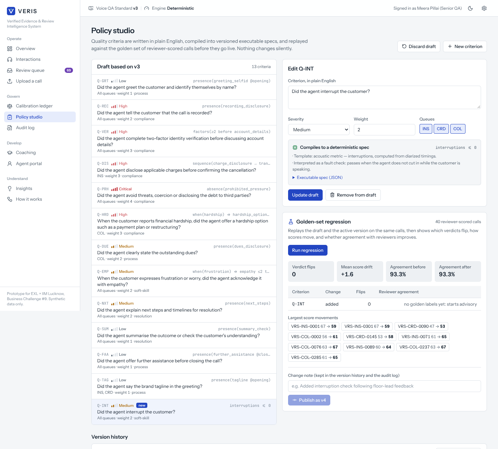
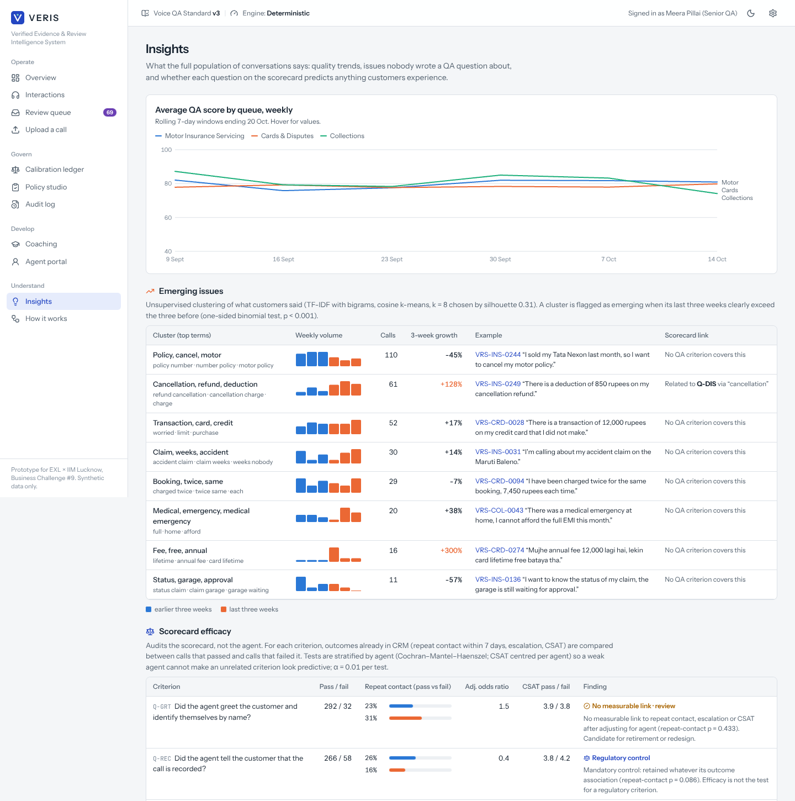
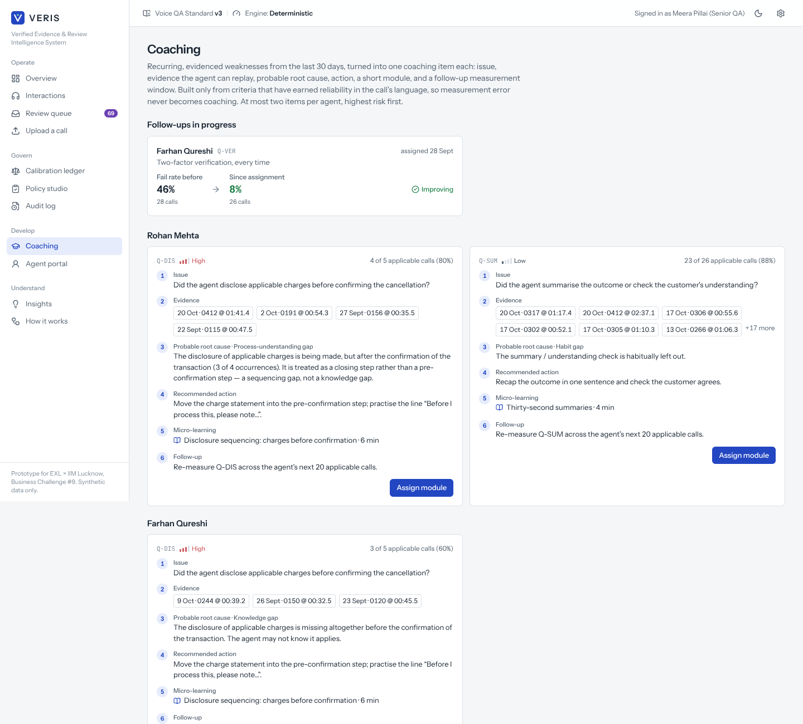
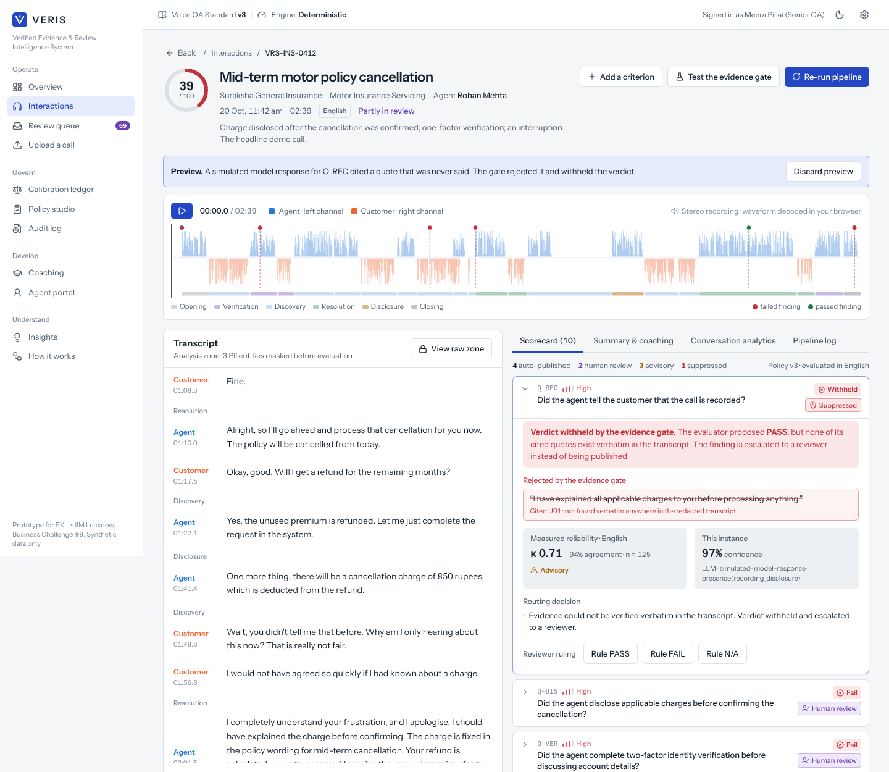

<div align="center">

# VERIS

**Verified Evidence & Review Intelligence System**

Governed, evidence-gated quality assurance for contact centres.
Functional prototype for **EXL × IIM Lucknow Live Action Project — Business Challenge #9: Contact Center Call Auditing & QA**.

[](https://github.com/OWNER/veris/actions/workflows/ci.yml)
[](https://github.com/OWNER/veris/actions/workflows/deploy.yml)


**[Live demo](https://OWNER.github.io/veris/)** · [Demo script](docs/DEMO_SCRIPT.md) · [Architecture](docs/ARCHITECTURE.md)



</div>

---

## The idea in one paragraph

Every major contact-centre platform now scores 100% of calls with AI. What nobody can answer is *how far to trust those scores*, even though they drive coaching, ratings, incentives and compliance attestations. VERIS treats the QA engine as a **measurement instrument**: every score must be anchored to a verbatim, timestamped quote or it is not published; VERIS continuously measures its own agreement with senior reviewers **per criterion and per language**, and that measured agreement — not model confidence — decides what may be automated. Competitors made QA automated. VERIS makes it accountable.

## What this prototype actually does

Everything below runs in the browser and is computed live by the engine in [`src/engine`](src/engine). There is no mock UI and no hard-coded result.

| Capability from the submission | Where to see it | How it works here |
|---|---|---|
| **1. Evidence-gated scoring** | Any call → expand a finding → click the timestamp; *Test the evidence gate* | Every quote is located verbatim in the redacted transcript and bound to word-level audio time. Fabricated quotes are rejected and the verdict is withheld (`engine/evidence.ts`). |
| **2. Calibration Ledger** | *Calibration ledger* | Cohen's κ with 95% CI, raw agreement and confusion matrix per criterion × language, weekly trend, drift detection (`engine/calibration.ts`). |
| **3. Reliability-driven routing** | Routing chip on every finding | Auto-publish only if the criterion has earned reliability *in that language*; high/critical failures always go to a human; unevidenced verdicts are suppressed (`engine/router.ts`). |
| **4. Policy-as-code + golden-set regression** | *Policy studio*, or *Add a criterion* on a call | Plain English is compiled to an executable spec; drafts are replayed on 40 reviewer-scored calls showing verdict flips, score drift and agreement before/after; versions are immutable (`engine/compiler.ts`, `engine/regression.ts`). |
| **5. Scorecard efficacy** | *Insights → Scorecard efficacy* | Each criterion tested against repeat contact, escalation and CSAT, stratified by agent (Cochran–Mantel–Haenszel) to remove confounding (`engine/efficacy.ts`). |
| **6. Multilingual & code-mixed** | Demo call VRS-CRD-0907 | Utterance-level Hindi/English/Hinglish identification; reliability is tracked separately per language and never inferred across languages (`engine/lid.ts`). |
| **7. Agent contest loop** | *Agent portal → Contest*, then *Review queue* | Contests are adjudicated and the ruling becomes a labelled example that updates the ledger immediately. |
| Privacy as an architectural boundary | *View raw zone* on any call | Luhn-validated cards, Verhoeff-validated Aadhaar, PAN, phone, email, DOB, policy/account numbers are masked before any evaluation; raw-zone views are audit-logged (`engine/pii.ts`). |
| Coaching loop | *Coaching* | Issue → evidence → root cause → action → micro-learning → follow-up, built only from criteria that have earned reliability; before/after measurement of an assigned module. |
| Emerging-issue discovery | *Insights → Emerging issues* | TF-IDF with bigrams, cosine k-means (k by silhouette), cluster merging, binomial growth test (`engine/discovery.ts`). |
| Immutable audit trail | *Audit log → Verify chain / Simulate tampering* | SHA-256 hash chain over every ruling, contest, policy version and raw-zone access (`engine/audit.ts`). |
| Real audio | Any demo call | Five stereo recordings (agent left, customer right). The browser decodes them, draws per-channel waveforms and re-derives diarization from channel energy (`engine/audio.ts`). |
| Optional LLM tier | *Settings → Evaluation engine* | Claude, or any OpenAI-compatible model including self-hosted open-weight models, on redacted text only, with small/large model routing. Every model quote still passes the gate (`engine/llm.ts`). |

## Five-minute demo

1. **Overview** → open **VRS-INS-0412** (mid-term motor policy cancellation).
2. Expand **Q-DIS**. The charge was disclosed, but 31 s *after* the cancellation was confirmed. Click both timestamps and hear them. A keyword system would have passed this call.
3. Note the routing: high severity → human review, with the measured κ for this criterion in English.
4. **Add a criterion** → “Did the agent interrupt the customer?” → *Compile and run*. A new evidenced finding appears at 01:04.9, in advisory mode because it has not yet earned reliability. No code, no retraining.
5. **Test the evidence gate** → inject a fabricated quote → the verdict is withheld.
6. **Calibration ledger** → the Q-NXT drift, detected after a closing-script change on 6 Oct, reverted to advisory automatically.
7. **Insights** → the emerging cancellation-charge dispute cluster, which links straight back to Q-DIS.

The full script with talking points is in [`docs/DEMO_SCRIPT.md`](docs/DEMO_SCRIPT.md).

## Architecture



Details, including how each of the nine layers in the submission maps to code and what is real versus simulated, are in [`docs/ARCHITECTURE.md`](docs/ARCHITECTURE.md).

## What is real and what is simulated

**Real:** the engine (redaction, language ID, compiler, evaluator, evidence gate, ledger statistics, routing, regression, coaching, discovery, efficacy tests, audit chain), the stereo recordings and their in-browser analysis, and the LLM tier when a key is supplied.

**Simulated:** the 324-call pilot corpus and its senior-reviewer labels are generated from a seeded script, so no customer data is involved. The generator includes paraphrases the deterministic lexicon misses, so agreement is earned and uneven. Two scenarios are seeded so the governance features have something to find: a closing-script change on 6 October (drift) and a rise in cancellation-charge disputes (emerging issue). **The κ figures demonstrate the mechanism; they are not a claim about VERIS's real-world accuracy**, which can only be measured on a client's own calls during the pilot — exactly as the submission proposes.

The demo audio was synthesised with eSpeak NG from scripted conversations ([`scripts/hero_calls.json`](scripts/hero_calls.json)); word timestamps come from the synthesiser's own word events.

## Run it

Requires Node.js 18+.

```bash
npm install
npm run dev        # http://localhost:5173
npm test           # engine unit tests (vitest)
npm run build      # production build in dist/
```

### Deploy to GitHub Pages

1. Create a repository (for example `veris`) and push this project to its `main` branch.
2. In the repository, open **Settings → Pages** and set **Source** to **GitHub Actions**.
3. The `Deploy` workflow builds and publishes on every push to `main`. The site appears at `https://<your-user>.github.io/<repo>/`.
4. Replace `OWNER` in the badges and links at the top of this README with your GitHub user name.

The build uses relative paths and hash routing, so it works under any sub-path and on any static host.

### Use a real model (optional)

*Settings → Evaluation engine* → choose **Hybrid** (LLM only for criteria that compile to a semantic spec) or **LLM for all criteria**, then enter an API key. The key stays in memory for the browser tab and is never stored. For Anthropic the defaults are `claude-haiku-5-5` (routine calls) and `claude-sonnet-5-5` (long, code-mixed, critical or free-form evaluations). Pick **OpenAI-compatible** to point at vLLM, Ollama, LM Studio or another provider. In production, model calls belong behind a server-side proxy; calling from the browser is a prototype convenience.

### Upload your own call

*Upload a call* accepts a recording (stereo preferred) and/or a transcript (`Agent:` / `Customer:` lines or VERIS JSON). Recordings are transcribed through any OpenAI-compatible `/audio/transcriptions` endpoint configured in Settings.

### Regenerate the demo audio

```bash
pip install espeakng-loader numpy   # bundles the eSpeak NG library
python3 scripts/synthesize_audio.py # needs ffmpeg on PATH
```

## Project structure

```
src/
  engine/          framework-free TypeScript: the VERIS engine
    pipeline.ts      orchestration and stage log
    pii.ts           redaction (Luhn, Verhoeff, PAN, DOB, …) and offset mapping
    lid.ts           utterance-level language identification
    prepare.ts       redacted analysis-zone transcript, time maps, phase segmentation
    acoustics.ts     silence, holds, overtalk, interruptions, talk share, sentiment
    lexicon.ts       concept lexicon (English + romanised Hindi)
    compiler.ts      plain English → executable spec
    evaluate.ts      deterministic evaluator
    llm.ts           optional LLM evaluator, prompt, parsing, model routing
    evidence.ts      the evidence gate
    calibration.ts   Calibration Ledger: κ, CI, drift, status
    router.ts        reliability-driven routing
    regression.ts    golden-set replay
    coaching.ts      coaching items, root cause, follow-up effect
    discovery.ts     emerging-issue clustering
    efficacy.ts      scorecard efficacy (CMH, Fisher, Welch)
    audit.ts         SHA-256 hash-chained audit log
    audio.ts, asr.ts browser audio analysis and ASR adapters
  data/            policy versions, demo-call metadata, seeded corpus generator
  state/           application store (user actions persist; everything else is derived)
  pages/, ui/      the application
public/audio/      five stereo demo recordings
scripts/           audio synthesis, CLI reports on the engine
tests/             vitest suites
docs/              architecture, demo script, screenshots
```

Useful command-line reports:

```bash
npx tsx scripts/engine-report.ts    # Calibration Ledger + findings for the demo calls
npx tsx scripts/insights-report.ts  # clusters, efficacy, coaching, regression
```

## Screenshots

| | |
|---|---|
|  |  |
|  |  |
|  |  |

## Roadmap (from the submission)

| Phase | This prototype | Next |
|---|---|---|
| MVP / PoC | Done, and beyond: batch upload, ASR adapter, diarization, configurable plain-English scorecard, evidence binding, redaction, compliance, summary, coaching chain, dashboard, calibration panel | — |
| Pilot | Ledger, risk routing, review console, agent contest, policy registry with regression are implemented on simulated data | Live CCaaS connector, real blind reviewer sample on one queue (50–150 agents), LMS hand-off |
| Enterprise | — | Multi-tenant isolation, SSO/SCIM, CRM/WFM/BI integration, on-premise open-weight deployment, observability |
| Advanced | — | Real-time agent assist, omnichannel, predictive escalation, role-play coaching |

## Notes

- All names, brands (“Suraksha General Insurance”, “Unity Bank”), people and numbers in the demo are fictional. No EXL or client data is used, and the prototype makes no claim of affiliation beyond the challenge itself.
- Prepared by Subhranil Hazra, IIM Lucknow, for the EXL × IIM Lucknow Live Action Project (September–October 2026).

Licensed under the [MIT License](LICENSE).
